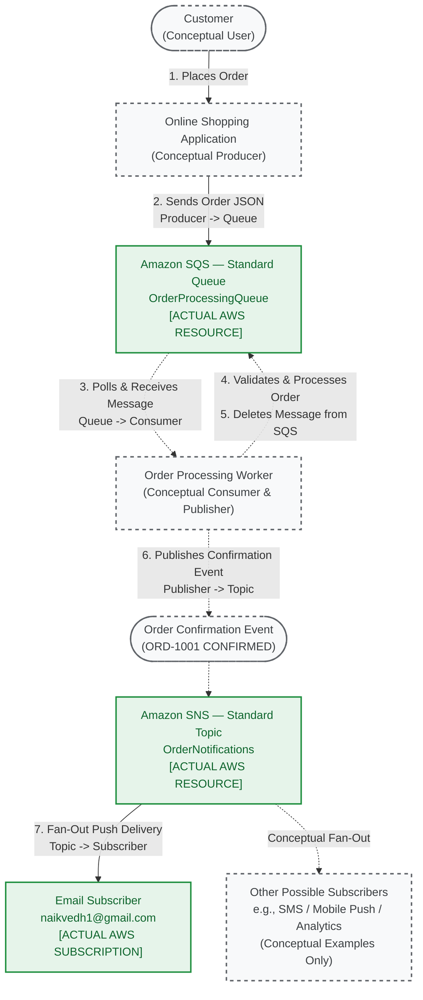

# Architecture — Case Study 15: Amazon SQS and Amazon SNS

## 1. Architecture Overview

This architecture demonstrates how an **Online Shopping Application** decouples **order processing** from **customer notifications** using **Amazon SQS** (point-to-point message queuing) and **Amazon SNS** (publish-subscribe notification delivery).

> **Scope Note (Implemented vs. Conceptual):**
> - **Actually Implemented in AWS (`ap-south-1`):** `OrderProcessingQueue` (Amazon SQS Standard Queue), `OrderNotifications` (Amazon SNS Standard Topic), and an Email Subscription (`naikvedh1@gmail.com`).
> - **Conceptual Application Components (Not Deployed):** The Online Shopping Application frontend/API, the Order Processing Worker (EC2/ECS/Lambda), and additional conceptual subscribers (e.g., SMS/Analytics). All Console operations were executed manually through the AWS Management Console to demonstrate the workflow without deploying backend compute.

---

## 2. Mermaid Architecture Diagram

---

## 3. Component Roles & Responsibilities

| Role | Component | Type | Responsibility |
| :--- | :--- | :--- | :--- |
| **User** | Customer | Conceptual | Places an order (e.g., Wireless Headphones, Qty: 1). |
| **Producer** | Online Shopping Application | Conceptual | Accepts the customer checkout request and sends the order JSON payload to `OrderProcessingQueue`. |
| **Message Queue** | Amazon SQS (`OrderProcessingQueue`) | **Actual AWS Resource** | Durably buffers incoming order messages so the application does not lose orders if the worker is busy or temporarily down. |
| **Consumer & Publisher** | Order Processing Worker | Conceptual | Polls `OrderProcessingQueue`, processes/validates the order, publishes an `OrderConfirmed` event to `OrderNotifications`, and explicitly deletes the message from SQS. |
| **Notification Topic** | Amazon SNS (`OrderNotifications`) | **Actual AWS Resource** | Receives the confirmation event from the publisher and fans it out to all confirmed subscribers. |
| **Subscriber** | Email Subscriber (`naikvedh1@gmail.com`) | **Actual AWS Subscription** | Receives the `Order Confirmed - ORD-1001` notification email pushed by SNS. |

---

## 4. Producer-to-Consumer Flow (Amazon SQS)

1. **Send (Producer → Queue):** The Shopping Application (demonstrated via AWS Console *Send message*) places the order JSON (`ORD-1001`) into `OrderProcessingQueue`.
2. **Buffer & Persist:** SQS stores the message redundantly across Availability Zones for up to the configured retention period (`4 Days`).
3. **Receive (Queue → Consumer):** The Order Processing Worker (demonstrated via AWS Console *Poll for messages*) retrieves the message.
4. **Visibility Timeout (`30 Seconds`):** Once received, the message becomes temporarily invisible to other consumers for 30 seconds so two workers do not process the same order simultaneously.
5. **Explicit Delete:** After processing succeeds, the consumer **must explicitly delete** the message from `OrderProcessingQueue`. Receiving a message does **not** automatically delete it—if the worker crashes before deleting, the message becomes visible again after 30 seconds for retry.

---

## 5. Publisher-to-Subscriber Flow (Amazon SNS)

1. **Subscribe & Confirm:** An endpoint (`naikvedh1@gmail.com` via `Email` protocol) subscribes to `OrderNotifications`. It remains in `PendingConfirmation` until the recipient manually clicks the confirmation link, preventing spam.
2. **Publish (Publisher → Topic):** Once the order is confirmed, the publisher (demonstrated via AWS Console *Publish message*) sends the confirmation subject and body to `OrderNotifications`.
3. **Fan-Out Push (Topic → Subscribers):** SNS immediately pushes the message to all confirmed subscribers. While this practical demonstrates one Email subscriber, SNS can fan out the same event simultaneously to multiple subscribers (Email, Lambda, SQS, HTTP/S, etc.).

---

## 6. Relationship Between SQS and SNS

- **No Automatic SQS → SNS Link:** Amazon SQS does **not** automatically forward or publish messages to Amazon SNS.
- **How They Work Together:** In a real application, the **Order Processing Worker** acts as the bridge:
  1. It **consumes** the raw order from SQS (`OrderProcessingQueue`).
  2. It validates payment/inventory and updates the database.
  3. It **publishes** the `Order Confirmed` event to SNS (`OrderNotifications`).
  4. It **deletes** the processed message from SQS.
- **Why Both Are Needed:**
  - **SQS** ensures reliable, one-to-one, asynchronous **work queuing** (pull-based) so no order is lost during traffic spikes.
  - **SNS** provides one-to-many, real-time **event broadcasting** (push-based) so multiple notification channels or downstream services can react to the confirmation at once.
