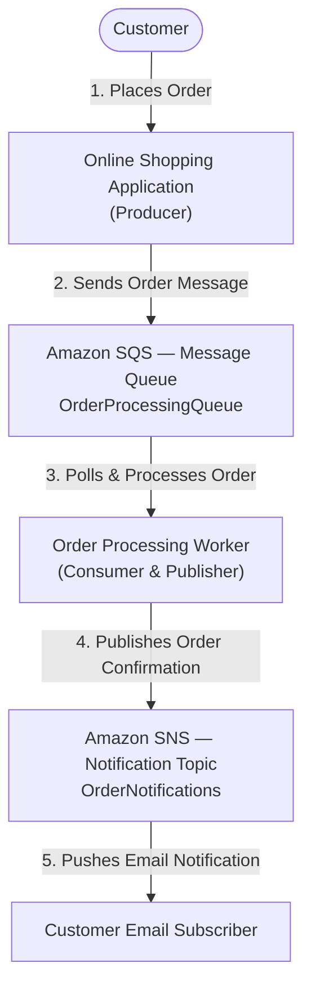
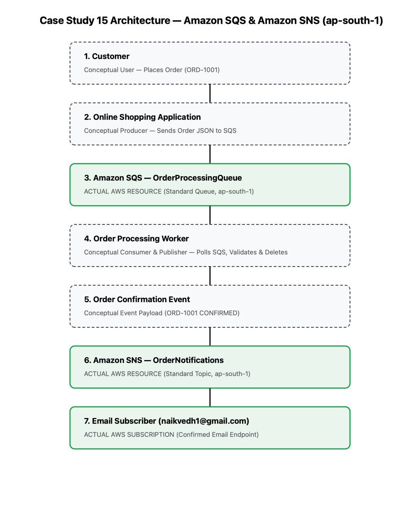

# Architecture — Case Study 15: Amazon SQS and SNS

## 1. Architecture Diagram

This diagram shows how an **Online Shopping Application** uses **Amazon SQS** (`OrderProcessingQueue`) for processing customer orders and **Amazon SNS** (`OrderNotifications`) for sending order notifications:

---

## 2. Component Roles

| Component | Role | Description |
| :--- | :--- | :--- |
| **Customer** | End User | Places an order on the online shopping website. |
| **Online Shopping Application** | Producer | Receives the order request and sends the order payload into the SQS queue. |
| **Amazon SQS (`OrderProcessingQueue`)** | Message Queue | Buffers incoming customer orders so no orders are lost during high traffic. |
| **Order Processing Worker** | Consumer & Publisher | Polls orders from SQS, processes them, publishes confirmation events to SNS, and deletes the processed SQS message. |
| **Amazon SNS (`OrderNotifications`)** | Notification Topic | Receives the order confirmation event and broadcasts it to all subscribed endpoints. |
| **Customer Email Subscriber** | Subscriber | Receives the *"Order Confirmed"* email notification pushed by Amazon SNS. |

---

## 3. End-to-End Communication Flow

1. **Order Placement (Producer → SQS Queue):**  
   When a customer buys a product, the **Online Shopping Application** sends an order message (`ORD-1001`) to **Amazon SQS (`OrderProcessingQueue`)**.
2. **Order Processing (SQS Queue → Consumer):**  
   The **Order Processing Worker** polls `OrderProcessingQueue`, retrieves the order message, validates and confirms the order, and deletes the message from the queue.
3. **Order Notification (Publisher → SNS Topic → Subscriber):**  
   Once the order is processed, the **Order Processing Worker** publishes an *"Order Confirmed"* message to **Amazon SNS (`OrderNotifications`)**, which immediately pushes the email notification to the **Customer Email Subscriber**.
