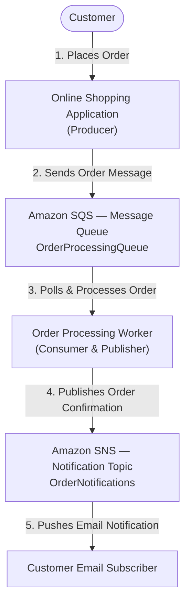
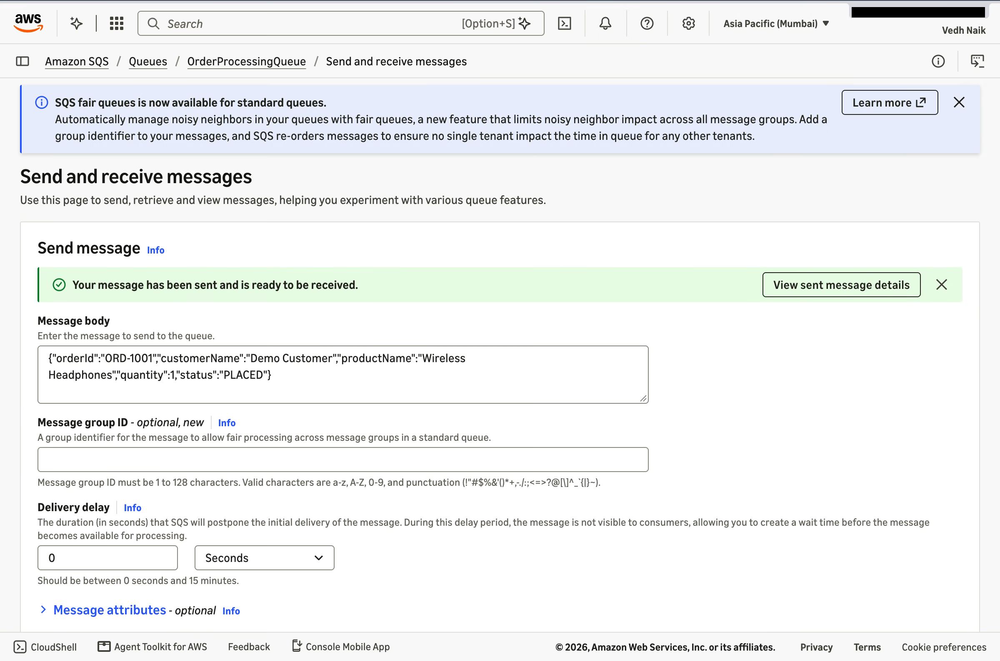
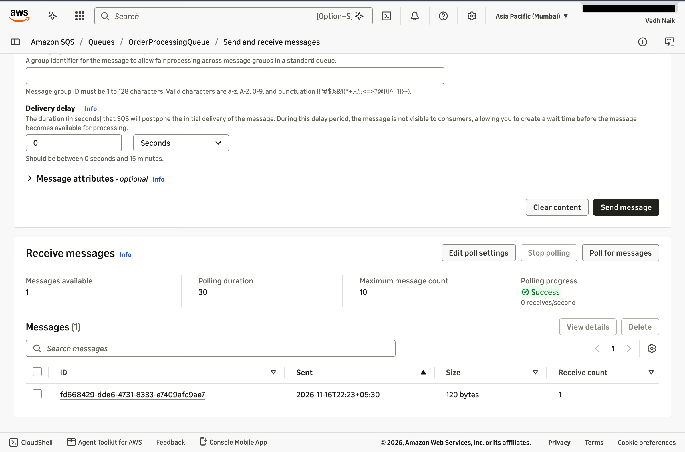
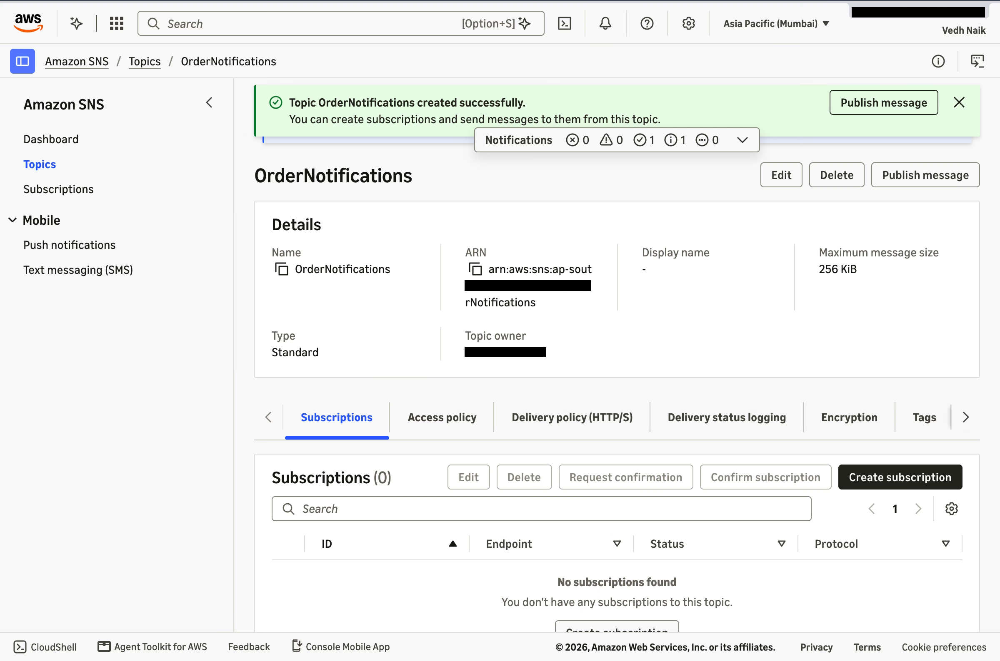
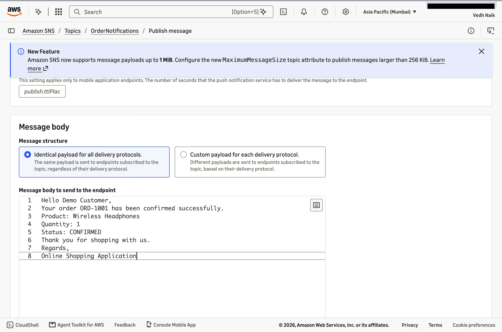

# Practical Report — Case Study 15: Amazon SQS and SNS

**Student Name:** Vedh Naik  
**Course:** B.Tech Computer Science Engineering  
**AWS Services:** Amazon SQS and Amazon SNS  
**Practical Activity:** Understand message queues and notification services  

---

## 1. Problem Statement
An online shopping application needs to send order notifications and process customer orders. It wants to understand how message queues and notification services help different application components communicate.

### Tasks
1. Explore **Amazon SQS** and **Amazon SNS** and explain the difference between a **message queue** and a **notification topic**.
2. Draw a simple **architecture diagram** showing how an online shopping application can use **SQS** for order processing and **SNS** for sending notifications.

---

## 2. Task 1: Explore Amazon SQS and Amazon SNS

### A. What is Amazon SQS (Message Queue)?
**Amazon Simple Queue Service (SQS)** is a fully managed **message queuing** service that lets application components communicate asynchronously using a **queue (waiting line)**:
- **Producer (Online Shopping Application):** When a customer places an order, the application sends the order details into the SQS queue (`OrderProcessingQueue`).
- **Queue (`OrderProcessingQueue`):** Stores and buffers incoming order messages safely so no orders are lost if the backend server is busy.
- **Consumer (Order Processing Worker):** Polls (pulls) one order message at a time from the queue, processes the order, and deletes the message from the queue once processing is complete.

### B. What is Amazon SNS (Notification Topic)?
**Amazon Simple Notification Service (SNS)** is a fully managed **publish-subscribe (pub/sub)** notification service that broadcasts messages through a **topic**:
- **Publisher (Order Processing Worker):** Once an order is confirmed, the worker publishes an order confirmation message to the SNS topic (`OrderNotifications`).
- **Topic (`OrderNotifications`):** Acts as a central broadcast channel for notifications.
- **Subscribers (Customer Email / Endpoints):** SNS immediately pushes the confirmation message to all subscribed endpoints (such as the customer's email address).

### C. Difference Between a Message Queue (SQS) and a Notification Topic (SNS)

| Feature | Message Queue (Amazon SQS) | Notification Topic (Amazon SNS) |
| :--- | :--- | :--- |
| **Core Purpose** | Buffers and queues tasks/orders for background processing | Sends real-time alerts and notifications to recipients |
| **Communication Model** | **Point-to-Point (1-to-1):** One message goes to one consumer | **Publish-Subscribe (1-to-Many):** One message is broadcast to all subscribers |
| **Delivery Mechanism** | **Pull (Polling):** Consumer pulls messages from the queue | **Push:** Topic immediately pushes messages to subscribers |
| **Message Persistence** | Stores messages in the queue (default **4 days**) until processed and deleted | Does not store messages like a queue; pushes immediately to confirmed subscribers |
| **Use in Online Shopping App** | **Order Processing (`OrderProcessingQueue`):** Holds customer orders in line until processed | **Order Notifications (`OrderNotifications`):** Sends *"Order Confirmed"* emails to customers |

---

## 3. Task 2: Simple Architecture Diagram

The diagram below illustrates how the **Online Shopping Application** uses **Amazon SQS** for order processing and **Amazon SNS** for sending order notifications:

### How the Architecture Works Step-by-Step
1. **Customer Places Order:** The customer places an order (`ORD-1001` — Wireless Headphones) on the Online Shopping Application.
2. **Send to SQS Queue:** The shopping application sends the order JSON message to **Amazon SQS (`OrderProcessingQueue`)**.
3. **Process Order from SQS:** The **Order Processing Worker** polls `OrderProcessingQueue`, retrieves the order message, validates and processes the order, and deletes the message from the queue.
4. **Publish to SNS Topic:** After confirming the order, the worker publishes an *"Order Confirmed"* message to **Amazon SNS (`OrderNotifications`)**.
5. **Send Notification to Subscriber:** **Amazon SNS** pushes the order confirmation notification directly to the subscribed **Customer Email**.

---

## 4. AWS Console Exploration (SQS & SNS Sandbox Demonstration)

### A. Exploring Amazon SQS (`OrderProcessingQueue`)

1. **Creating the Standard Queue (`OrderProcessingQueue`):**  
   In Amazon SQS (`ap-south-1`), a Standard queue named `OrderProcessingQueue` was created with default settings (`30 Seconds` visibility timeout and `4 Days` message retention).

   

2. **Sending a Sample Customer Order to SQS:**  
   Using *Send and receive messages*, a sample order payload (`ORD-1001` for Wireless Headphones) was sent to `OrderProcessingQueue`.

   

3. **Polling and Deleting the Processed Order Message:**  
   The order message was polled from `OrderProcessingQueue`, verified, and deleted after processing.

   

   

---

### B. Exploring Amazon SNS (`OrderNotifications`)

1. **Creating the Standard Topic (`OrderNotifications`):**  
   In Amazon SNS (`ap-south-1`), a Standard topic named `OrderNotifications` was created.

   

2. **Subscribing and Confirming the Customer Email Endpoint:**  
   An Email subscription (`naikvedh1@gmail.com`) was added to `OrderNotifications` and confirmed from the inbox.

   

3. **Publishing the Order Confirmation Notification:**  
   An order confirmation message (`Order Confirmed - ORD-1001`) was published to `OrderNotifications` and delivered to the subscribed email inbox.

   

   

---

## 5. Conclusion
Through this practical, we explored **Amazon SQS** and **Amazon SNS** and understood how they help different components of an online shopping application communicate:
- **Amazon SQS (`OrderProcessingQueue`)** acts as a **message queue** (1-to-1, pull-based) that reliably buffers customer orders for asynchronous processing.
- **Amazon SNS (`OrderNotifications`)** acts as a **notification topic** (1-to-many, push-based) that immediately sends order confirmation notifications to subscribed endpoints.
