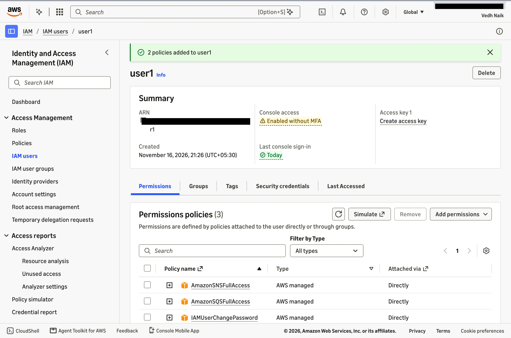
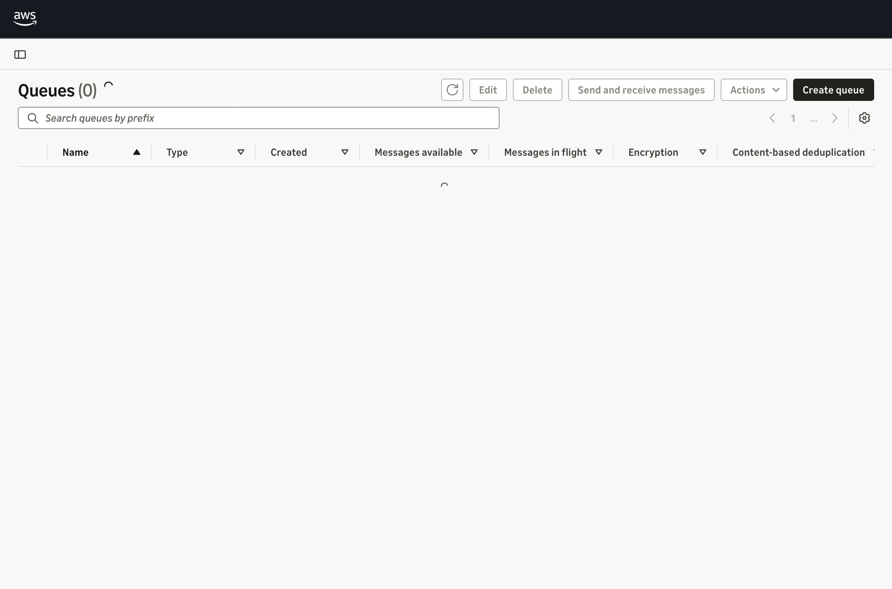
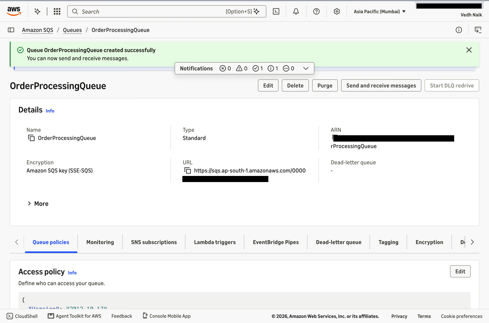
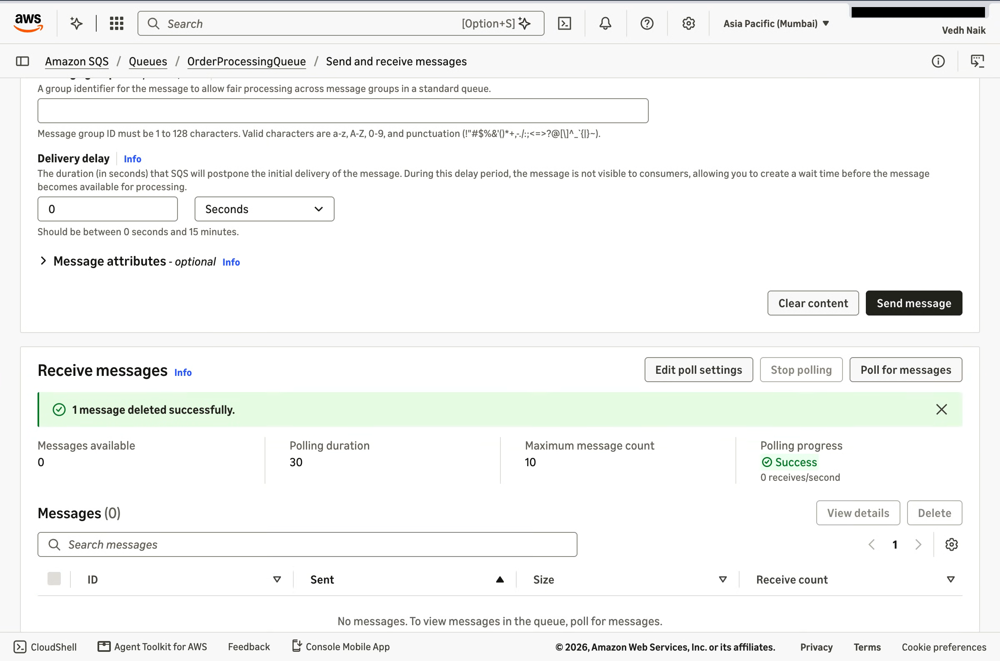
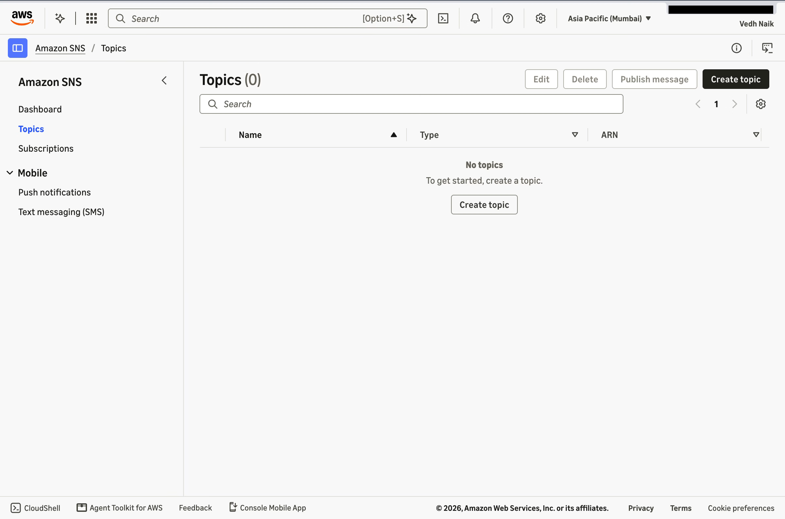
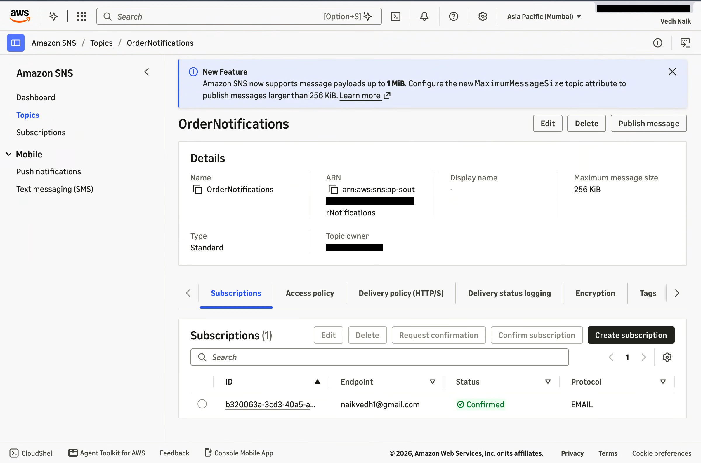
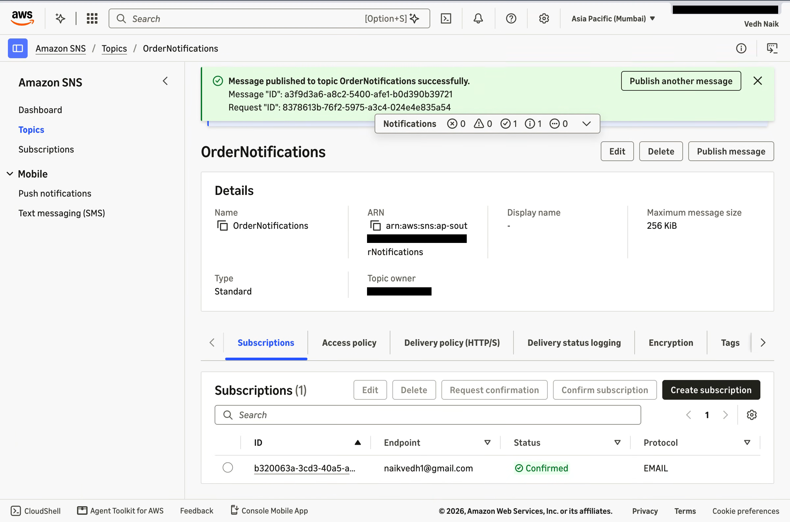
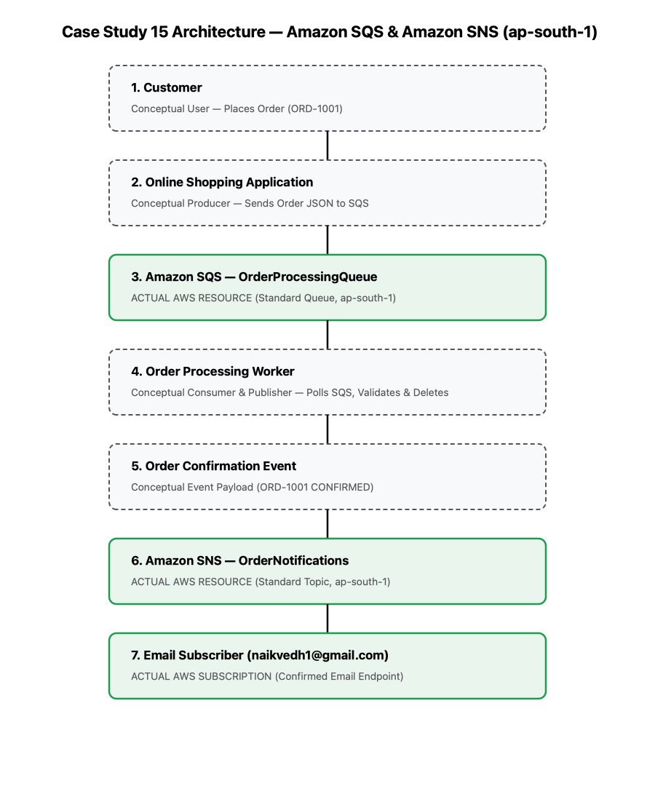

# Practical Report — Case Study 15: Amazon SQS and Amazon SNS

**Student Name:** Vedh Naik  
**Course:** B.Tech Computer Science Engineering  
**Practical Title:** Case Study 15 — Understand Message Queues (Amazon SQS) and Notification Services (Amazon SNS)  
**AWS Region:** `ap-south-1` (Asia Pacific — Mumbai)  
**Date:** November 16, 2026  

---

## 1. Aim
To implement and test **Amazon Simple Queue Service (SQS)** and **Amazon Simple Notification Service (SNS)** in the AWS Management Console (`ap-south-1`), understand the difference between a **message queue** and a **notification topic**, and design a decoupled order-processing and notification architecture for an online shopping application.

---

## 2. Problem Statement
> *"An online shopping application needs to send order notifications and process customer orders. It wants to understand how message queues and notification services help different application components communicate."*

---

## 3. Requirements & Scope Restrictions
- **AWS Account:** AWS Free Account Plan
- **Region:** `ap-south-1` (Asia Pacific — Mumbai)
- **IAM User:** `user1` (configured with `AmazonSQSFullAccess` and `AmazonSNSFullAccess`)
- **Permitted AWS Resources:**
  1. One Amazon SQS Standard Queue (`OrderProcessingQueue`)
  2. One Amazon SNS Standard Topic (`OrderNotifications`)
  3. One Email Subscription (`naikvedh1@gmail.com`)
- **Exclusions:** No EC2, Lambda, RDS, API Gateway, VPC, NAT Gateway, or SMS subscriptions. The shopping frontend and order-processing worker are represented conceptually and simulated via the AWS Console.

---

## 4. AWS Environment & IAM Setup
Before creating resources, the AWS Management Console environment was inspected and IAM permissions were configured:
- **Region Selected:** `Asia Pacific (Mumbai)` (`ap-south-1`)
- **Starting SQS State:** `Queues (0)` — `OrderProcessingQueue` did not exist prior to implementation.
- **Starting SNS State:** `Topics (0)` — `OrderNotifications` did not exist prior to implementation.
- **IAM Configuration:** Attached `AmazonSQSFullAccess` and `AmazonSNSFullAccess` managed policies to IAM user `user1` (`2 policies added to user1`).


*Explanation: Genuine AWS Console capture showing `AmazonSQSFullAccess` and `AmazonSNSFullAccess` attached to IAM user `user1` (with the 12-digit AWS Account ID redacted).*

---

## 5. Step-by-Step Implementation Procedure & Console Evidence

### Part A — Amazon SQS: Create `OrderProcessingQueue`
1. Navigated to **Amazon SQS → Queues** in `ap-south-1` and clicked **Create queue**.
2. Selected **Queue type:** `Standard` and entered **Name:** `OrderProcessingQueue`.
3. Kept baseline default configurations:
   - **Visibility timeout:** `30 Seconds`
   - **Message retention period:** `4 Days`
   - **Delivery delay:** `0 Seconds`
   - **Receive message wait time:** `0 Seconds`
   - **Maximum message size:** `1024 KiB`
   - **Encryption:** `Amazon SQS key (SSE-SQS)`
   - **Dead-letter queue:** Disabled (`-`)
4. Clicked **Create queue** and verified the banner: `"Queue OrderProcessingQueue created successfully"`.


*Explanation: Navigating to Amazon SQS in `ap-south-1` (Asia Pacific — Mumbai) to create and inspect `OrderProcessingQueue`.*


*Explanation: `OrderProcessingQueue` Details page confirming `Queue OrderProcessingQueue created successfully`, `Type: Standard`, `Encryption: Amazon SQS key (SSE-SQS)`, `Default visibility timeout: 30 Seconds`, and `Message retention period: 4 Days`.*

---

### Part B — Amazon SQS: Send, Poll, Inspect, and Delete Sample Order
1. Opened `OrderProcessingQueue` and clicked **Send and receive messages**.
2. In the **Message body** field, entered the sample order JSON:
   ```json
   {
     "orderId": "ORD-1001",
     "customerName": "Demo Customer",
     "productName": "Wireless Headphones",
     "quantity": 1,
     "status": "PLACED"
   }
   ```
3. Clicked **Send message** and verified the confirmation banner:
   - **Status:** `"Your message has been sent and is ready to be received."`
   - **Message ID:** `fd668429-dde6-4731-8333-e7409afc9ae7`
   - **MD5 of message body:** `48940e2d9e01afd5a8ddbd581e03054a`


*Explanation: AWS Console confirmation `"Your message has been sent and is ready to be received."` after sending the JSON payload for `ORD-1001` (`Message ID: fd668429-dde6-4731-8333-e7409afc9ae7`).*

4. In the **Receive messages** section, clicked **Poll for messages**.
5. Retrieved and opened message `fd668429-dde6-4731-8333-e7409afc9ae7`:
   - **Verified Body:** Matched the exact JSON sent above.
   - **Size:** `120 bytes`
   - **Receive count:** `1`


*Explanation: Polling `OrderProcessingQueue` retrieved message `fd668429-dde6-4731-8333-e7409afc9ae7` (`Receive count: 1`, `Size: 120 bytes`) and displayed the exact JSON order payload.*

6. **Explicit Deletion:** Selected message `fd668429-dde6-4731-8333-e7409afc9ae7`, clicked **Delete**, and confirmed deletion:
   - **Banner:** `"1 message deleted successfully."`
   - **Final Queue Count:** `Messages available: 0` (`Messages (0)`).


*Explanation: Confirmation banner `"1 message deleted successfully."` and `Messages (0)` showing that receiving and deleting an SQS message are distinct operations and no test messages remain.*

---

### Part C — Amazon SNS: Create `OrderNotifications` Topic
1. Navigated to **Amazon SNS → Topics** in `ap-south-1` and clicked **Create topic**.
2. Selected **Type:** `Standard` and entered **Name:** `OrderNotifications`.
3. Kept default settings and clicked **Create topic**.
4. Verified the banner: `"Topic OrderNotifications created successfully."`
   - **Topic ARN:** `arn:aws:sns:ap-south-1:<ACCOUNT_ID>:OrderNotifications`


*Explanation: Amazon SNS Topics view in `ap-south-1` (Asia Pacific — Mumbai).*


*Explanation: `OrderNotifications` Details page confirming `"Topic OrderNotifications created successfully."` with `Type: Standard` in `ap-south-1`.*

---

### Part D — Amazon SNS: Create & Confirm Email Subscription
1. Inside `OrderNotifications`, clicked **Create subscription**.
2. Selected **Protocol:** `Email` and entered **Endpoint:** `naikvedh1@gmail.com`.
3. Clicked **Create subscription** and verified:
   - **Subscription ID:** `b320063a-3cd3-40a5-afbb-d5b18f691d10`
   - **Initial Status:** `Pending confirmation`
4. Opened the `naikvedh1@gmail.com` inbox, located the **AWS Notification - Subscription Confirmation** email, and clicked **Confirm subscription**.
5. Refreshed the SNS Console and verified the status updated to **`Confirmed`**.


*Explanation: `OrderNotifications` Subscriptions tab showing endpoint `naikvedh1@gmail.com` (`Protocol: EMAIL`, ID `b320063a-3cd3-40a5-afbb-d5b18f691d10`) with status `Confirmed`.*

---

### Part E — Amazon SNS: Publish Order Confirmation Notification
1. Opened `OrderNotifications` and clicked **Publish message**.
2. Entered:
   - **Subject:** `Order Confirmed - ORD-1001`
   - **Message body (Identical message for all delivery protocols):**
     ```text
     Hello Demo Customer,
     Your order ORD-1001 has been confirmed successfully.
     Product: Wireless Headphones
     Quantity: 1
     Status: CONFIRMED
     Thank you for shopping with us.
     Regards,
     Online Shopping Application
     ```
3. Clicked **Publish message** and verified AWS SNS accepted the publication:
   - **Banner:** `"Message published to topic OrderNotifications successfully."`
   - **SNS Message ID:** `a3f9d3a6-a8c2-5400-afe1-b0d390b39721`
   - **Request ID:** `8378613b-76f2-5975-a3c4-024e4e835a54`


*Explanation: Publishing the test order confirmation message (`Subject: Order Confirmed - ORD-1001`) to `OrderNotifications`.*


*Explanation: AWS SNS confirmation `"Message published to topic OrderNotifications successfully."` (`Message ID: a3f9d3a6-a8c2-5400-afe1-b0d390b39721`).*


*Explanation: Architecture diagram distinguishing actual AWS resources created in `ap-south-1` (solid green) from conceptual application components (dashed grey).*

---

## 6. Key Technical Observations
1. **Receiving vs. Deleting in SQS:** Polling a message from `OrderProcessingQueue` does **not** remove it from the queue. Instead, SQS starts the **30-second Visibility Timeout**, temporarily hiding the message from other consumers. Only when **Delete** is explicitly called is the message permanently removed.
2. **Opt-In Protection in SNS (`PendingConfirmation`):** SNS will not push notifications to an email endpoint until the recipient manually confirms the subscription link, preventing unauthorized email spamming.
3. **SNS Publication vs. Inbox Delivery:** When SNS returns `Message ID: a3f9d3a6-a8c2-5400-afe1-b0d390b39721`, it confirms that **SNS accepted and dispatched** the message to confirmed subscribers; actual inbox delivery is verified separately in the recipient's email client.
4. **SQS and SNS Are Independent:** SQS does not automatically forward messages to SNS. In a real application, a worker process polls SQS, processes the order, publishes the confirmation to SNS, and deletes the SQS message.

---

## 7. Results & Conclusion
All required tasks for **Case Study 15** were completed and verified in `ap-south-1` within the AWS Free account plan:
- **`OrderProcessingQueue` (SQS Standard Queue)** was created, tested with order `ORD-1001`, polled, inspected, and cleaned up (`0` pending messages).
- **`OrderNotifications` (SNS Standard Topic)** and its **`Email` subscription (`naikvedh1@gmail.com`)** were created, manually confirmed, and tested by publishing `Order Confirmed - ORD-1001`.
- Both resources remain active in `ap-south-1` for live college viva demonstration.
