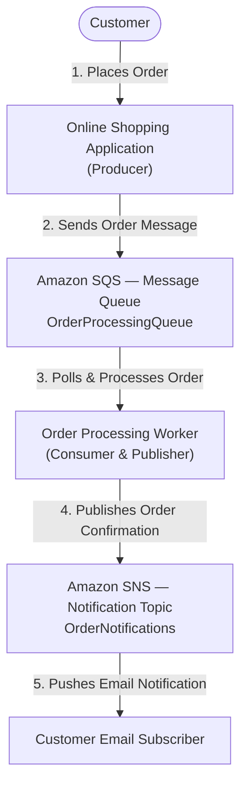
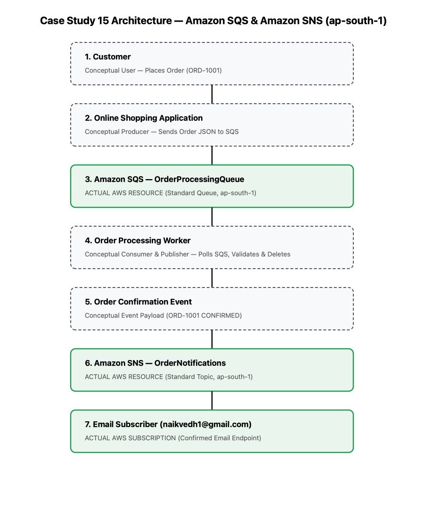

# Case Study 15: Amazon SQS and SNS

**Student Name:** Vedh Naik  
**Course:** B.Tech Computer Science Engineering  
**AWS Services:** Amazon SQS and Amazon SNS  
**Practical Activity:** Understand message queues and notification services  

---

## 1. Problem Statement
An online shopping application needs to send order notifications and process customer orders. It wants to understand how message queues and notification services help different application components communicate.

### Tasks
1. Explore **Amazon SQS** and **Amazon SNS** and explain the difference between a **message queue** and a **notification topic**.
2. Draw a simple **architecture diagram** showing how an online shopping application can use **SQS** for order processing and **SNS** for sending notifications.

---

## 2. Task 1: Difference Between a Message Queue (Amazon SQS) and a Notification Topic (Amazon SNS)

- **Amazon SQS (Simple Queue Service)** is a **message queue** service used to store and buffer messages between application components so a background worker can pull and process orders one by one without losing data.
- **Amazon SNS (Simple Notification Service)** is a **notification topic** (publish-subscribe) service used to push real-time notifications (such as email or SMS alerts) to all subscribed recipients when an event occurs.

| Feature | Message Queue (Amazon SQS) | Notification Topic (Amazon SNS) |
| :--- | :--- | :--- |
| **Purpose** | Queues tasks/orders for asynchronous background processing | Broadcasts notifications and alerts to subscribers |
| **Communication Model** | **Point-to-Point (1-to-1):** Producer → Queue → Consumer | **Publish-Subscribe (1-to-Many):** Publisher → Topic → Subscribers |
| **Delivery Model** | **Pull (Polling):** Consumer actively polls the queue for messages | **Push:** SNS immediately pushes notifications to subscribed endpoints |
| **Message Storage** | Retains messages in the queue (default **4 days**) until deleted | Does not store messages like a queue; pushes immediately to confirmed subscribers |
| **Role in Online Shopping App** | **`OrderProcessingQueue`:** Buffers customer orders (`ORD-1001`) for processing | **`OrderNotifications`:** Pushes *"Order Confirmed"* email notifications to customers |

---

## 3. Task 2: Simple Architecture Diagram

### Workflow Summary
1. **Customer** places an order on the **Online Shopping Application**.
2. **Online Shopping Application** sends the order details to **Amazon SQS (`OrderProcessingQueue`)**.
3. **Order Processing Worker** polls `OrderProcessingQueue`, processes the customer order, and deletes the message from the queue.
4. **Order Processing Worker** publishes an *"Order Confirmed"* event to **Amazon SNS (`OrderNotifications`)**.
5. **Amazon SNS** pushes the order confirmation email to the subscribed **Customer Email**.

---

## 4. Repository Files
- [PRACTICAL-REPORT.md](./PRACTICAL-REPORT.md) — Complete practical report with Task 1, Task 2, and AWS Console screenshots
- [ARCHITECTURE.md](./ARCHITECTURE.md) — Detailed architecture diagram and component explanation
- [CaseStudy15-SQS-SNS-Report.pdf](./CaseStudy15-SQS-SNS-Report.pdf) — Printable PDF report
- [EVIDENCE/](./EVIDENCE/) — AWS Console screenshots for SQS and SNS
